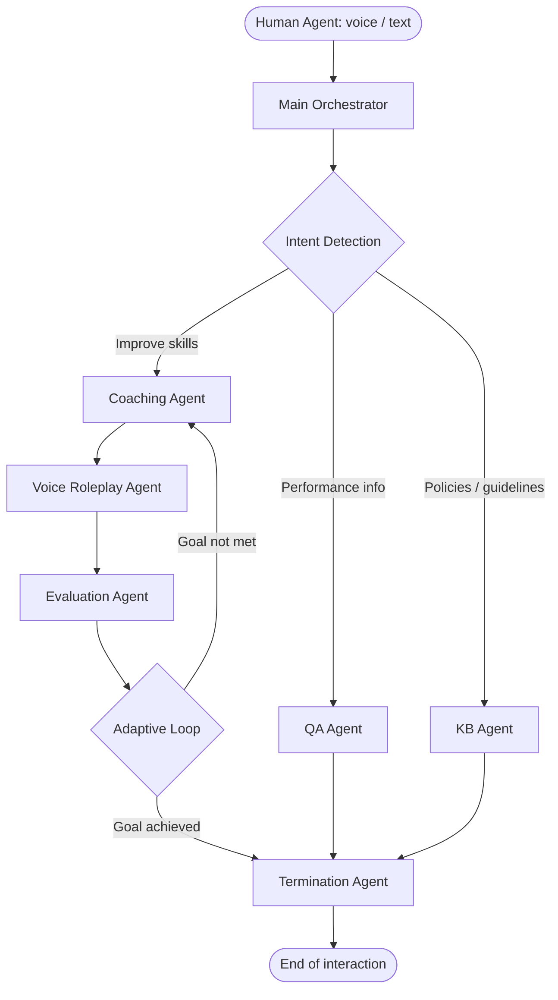

# 🎧 AI-Powered Personalized Coaching Loop

**A multi-agent system that turns QA feedback into hands-on practice for customer-service agents.**

Built during the Konecta GenAI internship program. The system identifies an agent's weaknesses, coaches them, runs a **voice roleplay** based on a realistic scenario, evaluates the result, and decides the next step, closing the loop between feedback and improvement.


---

## 📌 Table of Contents

- [The Problem](#-the-problem)
- [The Solution](#-the-solution)
- [Architecture](#-architecture)
- [Agents & Model Selection](#-agents--model-selection)
- [Tech Stack](#-tech-stack)
- [Quality, Safety & Reliability](#-quality-safety--reliability)
- [Getting Started](#-getting-started)
- [Future Improvements](#-future-improvements)
- [Team](#-team)
- [Acknowledgements](#-acknowledgements)
- [References](#-references)

---

## 🚨 The Problem

Contact centers handle huge volumes of interactions, which makes continuous, personalized coaching hard to sustain:

- Supervisors juggle coaching with daily operations, so each agent gets limited individual attention.
- Traditional QA can **identify** problems and give feedback, but feedback alone doesn't give agents a chance to **practice** the right behavior.
- As headcount grows, timely personalized coaching requires more and more supervisor time, and the same issues keep reappearing.

## 💡 The Solution

Instead of stopping at:

```
QA Feedback → Agent Reads Feedback
```

this project supports a full improvement cycle:

```
Identify Weakness → Coach → Practice → Evaluate → Improve
```

A single conversational entry point (voice or text) routes each request to the right specialist agent. The coaching path runs as an **adaptive loop**: it analyzes the agent's weaknesses, generates a targeted roleplay, evaluates how it went, and decides whether another coaching round is needed.

---

## 🏗 Architecture

A single user-facing agent orchestrates specialized worker agents. A centralized **Intent Detection** layer classifies each request and routes it to one of three paths, and every path ends at the **Termination Agent**.



### Design decisions

| Decision | Rationale |
|---|---|
| **Multi-agent** instead of one big LLM | Better controllability, more focused prompts, easier debugging, and each task can use the best-fit tools and model. Capabilities can be extended without redesigning the system. |
| **Intent detection layer** | Users never need to know which agent handles what. One seamless point of interaction. |
| **Separate QA and KB agents** | They use different information sources: the QA Agent retrieves agent-specific performance data via tools, while the KB Agent retrieves grounded project knowledge. Separation reduces prompt complexity and unnecessary tool calls. |
| **Coaching loop** | Turns static scores and feedback into an actionable *Assess → Coach → Practice → Evaluate* cycle. |
| **Tools for dynamic data** | Quality reports, agent profiles, and saved coaching outcomes live outside the model, so the system always works with up-to-date data. |

---

## 🤖 Agents & Model Selection

Each agent has its own role, objectives, constraints, tools, and expected behavior. Models are matched to task complexity, latency, and cost rather than using the most powerful model everywhere.

| Agent | Responsibility | Model |
|---|---|---|
| **Intent Detection** | Classifies the user's goal and routes the request (speed and reliable classification) | Speed-optimized |
| **QA Agent** | Retrieves agent-specific quality reports and scores via tools | Gemini 3.1 Flash-Lite |
| **KB Agent** | Answers from the project knowledge base (policies, standards, guidelines) | Gemini 2.5 Flash-Lite |
| **Coaching Agent** | Interprets performance info and builds a personalized coaching plan and scenario | Gemini 3.1 Flash-Lite |
| **Roleplay Agent** | Plays the customer in a low-latency, natural voice conversation | Gemini 3.1 Flash-Lite |
| **Evaluation Agent** | Assesses the roleplay outcome and produces feedback | Gemini 3.1 Flash-Lite |
| **Termination Agent** | Detects the endpoint, delivers the closing response, and ends the call | Gemini 3.1 Flash-Lite |

---

## 🧰 Tech Stack

- **[ElevenLabs](https://elevenlabs.io/docs)**: real-time, natural-sounding voice conversations. Important for practicing tone, empathy, clarification, and handling difficult customers.
- **[Supabase](https://supabase.com/docs)**: ready-to-use database for agent profiles, QA results, scores, and training results. Components talk to it directly, so no extra tunneling tools are needed.
- **[Google Gemini API](https://ai.google.dev/gemini-api/docs)**: LLMs powering the agents.

---

## 🛡 Quality, Safety & Reliability

- **Workflow guardrails**: routing rules, validation checks, and termination conditions prevent incorrect transfers, unnecessary loops, and conversations that run on.
- **Error handling**: missing inputs trigger clarification requests; tool or retrieval failures trigger a fallback response instead of unsupported answers.
- **Agent responsibility boundaries**: each agent has a defined scope, specific tools, and expected outputs, which makes the system easier to monitor, test, and maintain.
- **Transparent fallback strategy**: when the system can't confidently understand or complete a request, it avoids guessing and either says so clearly or asks for clarification.
- **Grounded knowledge**: the KB agent provides policies and standards without inventing unsupported company-specific information.

---

## 🚀 Getting Started

> Update this section with your exact setup steps and repository layout.

### Prerequisites

- An [ElevenLabs](https://elevenlabs.io) account with Conversational AI access
- A [Supabase](https://supabase.com) project
- A [Google Gemini API](https://ai.google.dev) key

### Setup

```bash
# 1. Clone the repository
git clone https://github.com/<your-username>/<your-repo>.git
cd <your-repo>

# 2. Configure environment variables
cp .env.example .env
# then fill in your ElevenLabs, Supabase, and Gemini credentials
```

### Configuration overview

1. **Database**: create the Supabase tables for agent profiles, QA results, scores, and training results.
2. **Knowledge base**: upload company policies and quality standards for the KB Agent.
3. **Agents**: configure each agent in ElevenLabs with its prompt, tools, and model as listed above.
4. **Tools**: connect the tools that read QA reports and agent profiles and save coaching outcomes to Supabase.

---

## 🔭 Future Improvements

The current release is a complete, stable MVP. The architecture was designed to grow in these directions:

- **Automated QA from real customer calls**: `Customer Call → Transcript → Automated QA Analysis → Quality Report → Personalized Coaching`. Detect issues such as interruptions, low empathy, or poor call control, and feed them directly into the coaching workflow.
- **Management dashboard & enterprise integration**: supervisor view of quality scores, trends, common team weaknesses, coaching history, and progress over time, plus integration with existing call-center, CRM, QA, or HR platforms.
- **Company-adaptable architecture**: swap in company-specific knowledge bases, QA rubrics, policies, terminology, escalation procedures, and success thresholds without changing the core workflow.
- **Independent Practice Mode**: let agents self-start practice on skills like handling angry customers, showing empathy, active listening, managing interruptions, complaints, or escalation procedures, followed by evaluation and feedback.

---

## 👥 Team

| Name | Contribution |
|---|---|
| Nouran Hassan | Workflow architecture and prompt design |
| Ziad Ezzat | Workflow architecture and prompt design |
| Rawan Badr | Workflow architecture and prompt design |
| Nouran Tarek | Workflow architecture and prompt design |
| Zyad Mahmoud | Tool development and Supabase integration |

All team members contributed to prompt refining, testing, the report, and the presentation.

**Supervised by** Eng. Hossam Elsayed.

---

## 🙏 Acknowledgements

Our sincere gratitude to our mentor, Hossam El Sayed, and to the Konecta mentors for their continuous guidance, support, and valuable feedback throughout the project.

---

## 📚 References

- [ElevenLabs Documentation](https://elevenlabs.io/docs)
- [Supabase Documentation](https://supabase.com/docs)
- [Google Gemini API Documentation](https://ai.google.dev/gemini-api/docs)
- Berg, J., Chandra Das, A., Gupta, V., & Kline, P. (2018). *Smarter call-center coaching for the digital world.* McKinsey & Company. ([link](https://www.mckinsey.com.br/capabilities/operations/our-insights/smarter-call-center-coaching-for-the-digital-world))
- Team Plivo (2025). [The Hidden Costs of Customer Service Agent Turnover and How to Reduce Them.](https://www.plivo.com/blog/hidden-costs-of-customer-service-agent-turnover-and-how-to-reduce-them/)
- Liveops (2026). [LiveNexus by Liveops: AI Simulations Accelerate Agent Readiness and Lift Sales Conversions by 57%.](https://liveops.com/pr/livenexus-by-liveops-ai-simulations-accelerate-agent-readiness-and-lifts-sales-conversions-by-57/)
- TELUS Digital. [TELUS Contact Center Agent Training with AI.](https://www.telusdigital.com/insights/customer-experience/resource/telus-contact-center-agent-training-ai)
